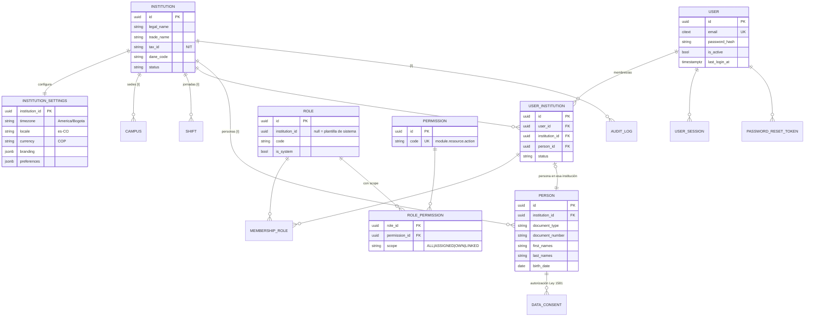
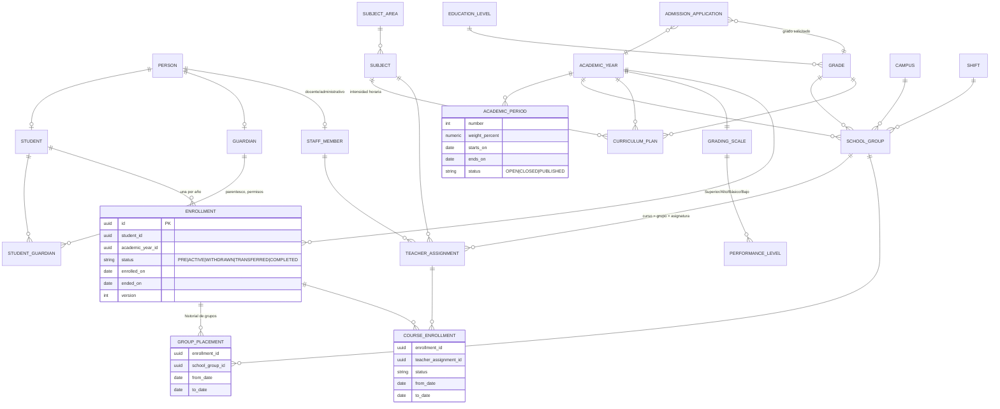
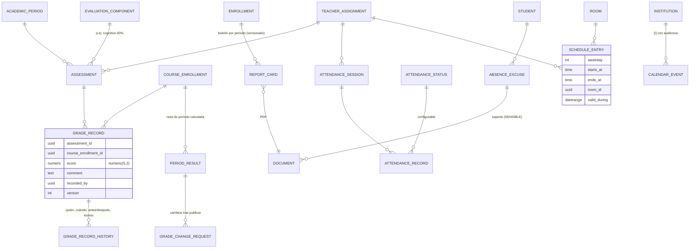
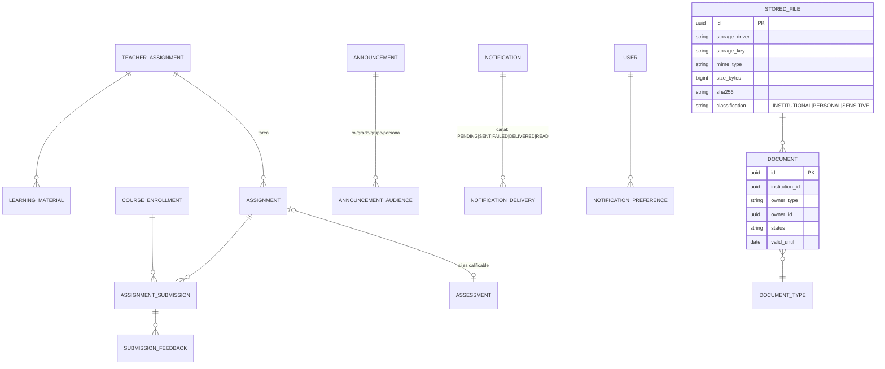

# EduCore — Diagnóstico del repositorio y plan de implementación

> Familia PeopleCore · "La gestión educativa, conectada en un solo lugar" (eslogan provisional)
> Fecha del diagnóstico: 2026-10-18 · Estado: **propuesta pendiente de confirmación** (sección 11)

---

## 1. Estado actual del proyecto

Lo que se inspeccionó realmente:

| Elemento                | Hallazgo                                                                                                                                                                                                                   |
| ----------------------- | -------------------------------------------------------------------------------------------------------------------------------------------------------------------------------------------------------------------------- |
| `C:\wamp64\www\EduCore` | **Directorio vacío.** No hay código, dependencias, esquema, pruebas, `.env` ni documentación previa.                                                                                                                       |
| Control de versiones    | **No es un repositorio Git.**                                                                                                                                                                                              |
| Servidor web            | Apache (WAMP) escucha en `0.0.0.0:80`, su `DocumentRoot` es `C:\wamp64\www`, y `http://localhost/EduCore/` responde **200**. La regla del vhost es `Require local granted`.                                                |
| PostgreSQL              | El servicio `postgresql-x64-18` está **en ejecución** (psql 18.6) y escucha en `:5432`. También existe `C:\Program Files\PostgreSQL\17\data` **sin binarios**, al parecer residuo de una instalación anterior. No se tocó. |
| MySQL/MariaDB           | WAMP escucha en `:3306`. No se usa para EduCore.                                                                                                                                                                           |
| Docker                  | **No instalado.**                                                                                                                                                                                                          |
| Node / npm              | Node **20.19.0**, npm 11.6.2. pnpm y yarn no están instalados.                                                                                                                                                             |

Conclusión: es un proyecto **greenfield**. No hay estructura previa que respetar ni datos que proteger dentro del proyecto. No se pudo validar la conexión a PostgreSQL porque eso requiere credenciales, y no se buscaron ni se leyeron.

## 2. Tecnologías y versiones

### Instaladas en la máquina

- Node 20.19.0. **La línea 20 llegó a fin de soporte (EOL) en abril de 2026.**
- PostgreSQL 18.6 (servicio local).
- Git 2.55.

### Versiones estables actuales en el registro npm (consultadas hoy)

| Paquete                                                                                       | `latest`                      | Requisito de Node      | Observación                                                                                                                  |
| --------------------------------------------------------------------------------------------- | ----------------------------- | ---------------------- | ---------------------------------------------------------------------------------------------------------------------------- |
| @nestjs/core                                                                                  | 12.1.3 (11.2.7 en `legacy`)   | ≥ 20                   | La 12.0.0 salió el 2026-08-27, hace ~7 semanas.                                                                              |
| prisma / @prisma/client                                                                       | 7.10.1 (8.0 aún en RC)        | ^20.19 · ^22.12 · ≥ 24 | Prisma 7 usa `prisma.config.ts`, el generador `prisma-client` y el driver adapter `@prisma/adapter-pg`. **No usar la RC 8.** |
| react                                                                                         | 19.3.1                        | —                      |                                                                                                                              |
| vite                                                                                          | 8.3.4                         | ^20.19 · ≥ 22.12       |                                                                                                                              |
| react-router                                                                                  | 8.4.0 (7.18.4 en `version-7`) | v8 exige **≥ 22.22**   | Con Node 20 solo es posible la v7.                                                                                           |
| @tanstack/react-query                                                                         | 5.104.4                       | —                      |                                                                                                                              |
| tailwindcss                                                                                   | 4.3.3                         | —                      | shadcn/ui es compatible con Tailwind 4 y React 19.                                                                           |
| zod                                                                                           | 4.6.7                         | —                      |                                                                                                                              |
| class-validator                                                                               | 0.15.1                        | —                      |                                                                                                                              |
| argon2                                                                                        | 0.45.1                        | ≥ 16.17                | Módulo nativo con binarios precompilados para Windows.                                                                       |
| typescript                                                                                    | 7.0.2                         | —                      | Se verificará su compatibilidad con Nest/Prisma antes de fijarla; si hay problemas, se usará 5.9.x.                          |
| pg-boss                                                                                       | 12.38.0                       | —                      | Cola de trabajos sobre PostgreSQL.                                                                                           |
| nestjs-pino 5.3.1 · recharts 3.10.1 · exceljs 4.4.0 · pdfmake 0.3.12 · @aws-sdk/client-s3 3.x |                               |                        |                                                                                                                              |

Las versiones exactas se fijarán en `package.json` al iniciar la Fase 0 y se volverán a comprobar en ese momento.

## 3. Módulos existentes y faltantes

- **Existentes:** ninguno.
- **Faltantes:** todos los del alcance. La sección 10 los ordena por prioridad.

## 4. Riesgos técnicos y de seguridad

| #   | Riesgo                                                                                                                                                                                                                                                                            | Severidad | Mitigación propuesta                                                                                                                                                                                                                          |
| --- | --------------------------------------------------------------------------------------------------------------------------------------------------------------------------------------------------------------------------------------------------------------------------------- | --------- | --------------------------------------------------------------------------------------------------------------------------------------------------------------------------------------------------------------------------------------------- |
| R1  | **El proyecto está dentro del `DocumentRoot` de Apache.** Cualquier `.env`, backup o archivo subido en este árbol se podría descargar en `http://localhost/EduCore/...`. Hoy solo se permite acceso local, pero cualquier cambio de configuración de WAMP expondría los secretos. | Alta      | Mover el proyecto fuera de `www` (p. ej. `C:\dev\educore`) **o** añadir una denegación explícita para esta ruta en Apache. El almacenamiento de archivos de desarrollo irá en cualquier caso fuera del árbol web.                             |
| R2  | Node 20 está en EOL y bloquea React Router 8 y el CLI de Prisma 8.                                                                                                                                                                                                                | Media     | Actualizar a **Node 24 LTS** antes de empezar.                                                                                                                                                                                                |
| R3  | No hay control de versiones.                                                                                                                                                                                                                                                      | Media     | Ejecutar `git init` con un `.gitignore` que excluya `.env*`, `storage/` y `node_modules` desde el primer commit.                                                                                                                              |
| R4  | Credenciales de PostgreSQL desconocidas. La app no debe usar el superusuario `postgres`.                                                                                                                                                                                          | Media     | Crear dos roles: `educore_owner` (dueño del esquema, solo para migraciones) y `educore_app` (DML de mínimo privilegio). Crear dos bases: `educore_dev` y `educore_test`. Entregaré el script SQL; el usuario lo ejecuta con sus credenciales. |
| R5  | Sin Docker no hay paridad entre desarrollo y producción.                                                                                                                                                                                                                          | Baja      | En desarrollo se usa el PostgreSQL 18 local. Para producción se entrega `docker-compose` como opción, sin que el desarrollo dependa de él.                                                                                                    |
| R6  | Datos de menores y datos sensibles (salud en excusas médicas) — Ley 1581 de 2012, art. 5–7.                                                                                                                                                                                       | Alta      | Clasificar archivos y campos, cifrar en tránsito y en reposo, restringir y auditar el acceso, registrar las autorizaciones de tratamiento y minimizar la información en logs.                                                                 |
| R7  | Asumir una sola institución en el código.                                                                                                                                                                                                                                         | Media     | `institution_id` en todas las entidades institucionales desde el día 1 (sección 8).                                                                                                                                                           |
| R8  | Ediciones concurrentes en notas, matrículas y cierres.                                                                                                                                                                                                                            | Media     | Bloqueo optimista con columna `version`, índices únicos parciales, `SELECT … FOR UPDATE` o advisory locks en los cierres, y claves de idempotencia.                                                                                           |
| R9  | NestJS 12 es muy reciente y algunos paquetes del ecosistema podrían no soportarlo aún.                                                                                                                                                                                            | Baja      | Ver la decisión D3.                                                                                                                                                                                                                           |

## 5. Arquitectura propuesta

**Monolito modular** en un monorepo con **npm workspaces**, que ya vienen con npm y no exigen instalar pnpm.

```
Navegador (React SPA) ──HTTPS──> Proxy inverso (Nginx/Caddy) ──> API NestJS /api/v1
                                                                 │  ├─ Prisma 7 ─> PostgreSQL 18
                                                                 │  ├─ StorageDriver ─> disco privado | S3 compatible
                                                                 │  ├─ pg-boss (jobs: notificaciones, PDF, importaciones)
                                                                 │  └─ NotificationProvider ─> SMTP | (futuro: SMS/WhatsApp/push)
```

### Backend (`apps/api`)

- NestJS con un módulo por dominio. Cada módulo se separa en `controller` (HTTP, DTO) → `service` (reglas de negocio, transacciones) → `repository` (consultas Prisma).
  - No habrá consultas Prisma fuera de los repositorios.
- **Autenticación:**
  - Access token JWT de 15 min, guardado solo en memoria del cliente.
  - Refresh token opaco, rotativo, en cookie `httpOnly; Secure; SameSite=Strict; Path=/api/v1/auth`. Se guarda hasheado en `user_session` y, si se reutiliza un token ya rotado, se revoca toda la familia.
  - Protección CSRF en `/auth/refresh` y `/auth/logout` con un encabezado personalizado y verificación de `Origin`.
  - Este esquema también sirve para la futura app móvil.
- **Contraseñas:** Argon2id (`argon2`, parámetros OWASP: m=19 MiB, t=2, p=1). Recuperación con token de un solo uso, hasheado, que vence en 30 min. La respuesta es la misma exista o no la cuenta.
- **Fuerza bruta:** `@nestjs/throttler` por IP, más bloqueo progresivo por cuenta según la tabla `login_attempt`.
- **Autorización** en dos capas:
  1. `PermissionsGuard` comprueba que el rol tenga el código de permiso (`grades.record.write`).
  2. Un **policy por recurso** comprueba el alcance de los datos (`ALL`, `ASSIGNED`, `OWN`, `LINKED`). Por ejemplo, el docente solo califica en sus `teacher_assignment` y el acudiente solo ve a sus acudidos vinculados.
  - Ningún endpoint queda protegido solo por el frontend. La regla por defecto es denegar: un endpoint sin `@RequirePermission` o `@Public` falla en pruebas.
- **Contexto institucional:**
  - `RequestContext` (AsyncLocalStorage) lleva `userId`, `institutionId`, `membershipId`, `permissions` y `requestId`.
  - En la v1, `institutionId` se resuelve desde la membresía única del usuario.
  - Los repositorios reciben siempre `institutionId` de forma explícita.
- **Transversal:**
  - Errores con un filtro global y formato único: `{ error: { code, message, details?, requestId } }`.
  - Logs con `nestjs-pino`, en JSON y con redacción de `password`, `token`, `authorization`, `cookie` y documentos de identidad.
  - Seguridad HTTP con `helmet` y CORS limitado a la lista de `WEB_ORIGINS`.
  - Configuración validada con Zod al arrancar.
  - Swagger en `/api/docs`, deshabilitado en producción salvo que se active.
- **Paginación:** `?page&pageSize`, con un máximo de 100, o cursor en listados de alto volumen. La respuesta es `{ data, meta: { page, pageSize, total } }`.
- **Idempotencia:** el encabezado `Idempotency-Key` se exige en POST sensibles (matrícula, publicación, importación).
- **Archivos:**
  - Interfaz `StorageDriver` con dos implementaciones: `LocalPrivateStorage` (directorio fuera del árbol web) y `S3Storage` (MinIO, AWS o R2).
  - Se valida tamaño, MIME declarado y _magic bytes_, se calcula SHA-256 y se nombra con un UUID.
  - Las descargas pasan siempre por la API. Primero se verifica el permiso; luego el archivo se transmite directamente o se redirige a una URL prefirmada de ≤ 60 s.
- **Jobs:** pg-boss usa la misma base PostgreSQL, así que no hace falta Redis en la v1.
- **PDF / Excel:** `pdfmake` para boletines y certificados (sin Chrome headless) y `exceljs` y CSV para exportaciones.
- **Pruebas:**
  - Vitest para pruebas unitarias.
  - Vitest + Supertest para integración contra una base `educore_test` real; cada suite se aísla en una transacción o se limpia con `TRUNCATE` controlado.
  - Playwright para E2E de flujos críticos, a partir de la Fase 3.

### Frontend (`apps/web`)

- **Stack:** React 19, Vite 8, React Router (v7 o v8 según la decisión D1), TanStack Query 5, React Hook Form + Zod 4, Tailwind 4, shadcn/ui, Lucide y Recharts.
- **Cliente HTTP único** (`lib/api-client.ts`):
  - Inyecta el access token y lo renueva ante un 401 con una sola petición de refresh compartida.
  - Normaliza los errores.
  - Las URL de los endpoints viven en `services/*` de cada funcionalidad.
- **Navegación:** la barra lateral se genera desde un manifiesto de rutas que declara el permiso requerido. Solo es una ayuda visual; la API valida siempre.
- **Tema y marca:**
  - Tokens CSS (`--color-primary`, …) con tema claro por defecto y oscuro opcional.
  - La marca de la institución (nombre, logo, colores) se carga desde `GET /api/v1/institution/branding`.
- **Accesibilidad:** navegación por teclado (garantizada por los primitivos Radix de shadcn), contraste AA y mensajes en español.

### Paquete compartido (`packages/shared`)

Solo contiene lo que ambos lados necesitan sin acoplarlos: el catálogo de códigos de permiso, los enums de dominio (estados de matrícula, de asistencia, …) y los tipos de respuesta de la API. No incluye lógica de negocio.

### Paleta provisional

No hay una paleta oficial de PeopleCore en el repositorio, así que propongo una provisional. Cambiarla solo requiere modificar tokens.

| Token          | Claro                     | Oscuro                | Uso                |
| -------------- | ------------------------- | --------------------- | ------------------ |
| primary        | `#2453C4` (azul)          | `#6E93F0`             | Acciones y marca   |
| accent         | `#0E9384` (verde azulado) | `#3CCBB8`             | Aprendizaje, éxito |
| warning        | `#B45309`                 | `#F59E0B`             | Alertas            |
| danger         | `#B42318`                 | `#F97066`             | Errores            |
| surface / text | `#FFFFFF` / `#101828`     | `#0F1420` / `#E6E9F0` | Fondos y texto     |

## 6. Diagrama inicial de la base de datos

Convenciones:

- PK `id uuid` (UUID v7, ordenable en el tiempo), `created_at`/`updated_at timestamptz` y nombres de tabla en `snake_case`.
- Por defecto `ON DELETE RESTRICT`. `CASCADE` solo se usa en hijos puros como `role_permission`.
- Las entidades académicas y personales **no se borran**: se archivan con `status` o `archived_at`.
- `[I]` = tabla con `institution_id NOT NULL`.

### 6.1 Institución, identidad y permisos



### 6.2 Personas y estructura académica



`COURSE_ENROLLMENT` se materializa al ubicar al estudiante en un grupo. Cuando cambia de grupo, los cursos anteriores se cierran con fecha (`to_date`) y **no se eliminan**. Así se conserva el historial y el docente sigue viendo las notas que registró.

### 6.3 Evaluación, asistencia, horario



Los cruces de horario se impiden **en la base de datos** con restricciones `EXCLUDE USING gist`, una por docente y otra por aula, con `btree_gist`. Como Prisma no las genera, se crean en SQL dentro de la migración y se documentan.

### 6.4 Aula virtual, comunicación, documentos



Las tareas calificables crean un `ASSESSMENT` asociado. Así el aula virtual reutiliza el cálculo de notas sin duplicar su lógica.

### 6.5 Reglas de integridad clave

- `UNIQUE(institution_id, document_type, document_number)` en `person`.
- Índice único parcial `enrollment(student_id, academic_year_id) WHERE status IN ('PRE','ACTIVE')`.
- `UNIQUE(school_group_id, subject_id) ` en `teacher_assignment`, para el titular vigente.
- `UNIQUE(assessment_id, course_enrollment_id)` en `grade_record`.
- `CHECK`:
  - La suma de pesos por período se valida en el servicio y al cerrar el período.
  - `score` debe estar dentro de los límites de la escala.
  - `starts_on < ends_on`.
- `audit_log` es solo de inserción: el rol `educore_app` no tiene `UPDATE` ni `DELETE` sobre ella.

## 7. Matriz de roles y permisos (propuesta)

Alcance: **T** = toda la institución · **A** = asignado (sus cursos o grupos; un coordinador puede limitarse a niveles o sedes) · **P** = propio · **V** = estudiantes vinculados · **L** = solo lectura · **—** = sin acceso.

| Módulo / acción                                                          | Adm. técnico | Adm. institucional (rector) | Coordinador   | Docente                                 | Secretaría                                     | Estudiante     | Acudiente                                |
| ------------------------------------------------------------------------ | ------------ | --------------------------- | ------------- | --------------------------------------- | ---------------------------------------------- | -------------- | ---------------------------------------- |
| Configuración institucional                                              | T            | T                           | L             | —                                       | L                                              | —              | —                                        |
| Usuarios, roles, permisos                                                | T            | T (excepto rol técnico)     | L             | —                                       | Gestión de cuentas de estudiantes y acudientes | —              | —                                        |
| Estructura académica (años, períodos, grados, grupos, asignaturas, plan) | T            | T                           | A (L+propone) | L                                       | L                                              | —              | —                                        |
| Admisiones                                                               | L            | T                           | L             | —                                       | T                                              | —              | P (si se habilita la solicitud en línea) |
| Matrículas, retiros, traslados                                           | L            | T                           | L             | —                                       | T                                              | L/P            | L/V                                      |
| Asignación docente                                                       | L            | T                           | A             | L/P                                     | —                                              | —              | —                                        |
| Evaluaciones y registro de notas                                         | —            | L                           | A (L)         | A (período abierto)                     | —                                              | —              | —                                        |
| Cierre y publicación de período                                          | —            | T                           | A             | —                                       | —                                              | —              | —                                        |
| Cambio de nota publicada                                                 | —            | Aprueba                     | Aprueba (A)   | Solicita (A)                            | —                                              | —              | —                                        |
| Boletines                                                                | —            | T                           | A             | L/A                                     | T (generar e imprimir)                         | P (publicados) | V (publicados)                           |
| Asistencia                                                               | —            | L                           | A             | A                                       | L                                              | P              | V                                        |
| Excusas                                                                  | —            | L                           | A (aprueba)   | A (ve el estado, sin el soporte médico) | L                                              | P              | V (presenta)                             |
| Horarios y calendario                                                    | L            | T                           | A             | L/P                                     | L                                              | P              | V                                        |
| Aula virtual / tareas                                                    | —            | L                           | A (L)         | A                                       | —                                              | P (entrega)    | V (L)                                    |
| Comunicados                                                              | —            | T                           | A             | A (sus grupos)                          | T                                              | Recibe         | Recibe                                   |
| Documentos                                                               | Técnicos     | T                           | A             | A                                       | T                                              | P              | V (autorizados)                          |
| Reportes e indicadores                                                   | Técnicos     | T                           | A             | A                                       | Administrativos                                | —              | —                                        |
| Auditoría                                                                | T            | T                           | —             | —                                       | —                                              | —              | —                                        |

- Los roles son **plantillas editables por la institución**. La matriz es la configuración inicial; las reglas de alcance se aplican siempre en el backend.
- El rol "Adm. técnico" no ve datos académicos ni personales por defecto (mínimo privilegio). Si necesita hacerlo para soporte, el acceso se audita.

## 8. Estrategia: una institución hoy, multi-tenant mañana

**Decisión central: `institution_id NOT NULL` desde la primera migración** en todas las tablas institucionales (`[I]`) y en sus restricciones únicas compuestas. Las tablas hijas que heredan la institución de su padre (por ejemplo `grade_record` → `assessment`) no repiten la columna, salvo cuando se consultan con mucha frecuencia por institución, como `audit_log`, `document` y `notification`.

¿Por qué así y no "añadir la columna después"?

- La migración futura de "asociar los registros existentes a la institución inicial" pasa a ser **trivial**: ya están asociados.
- Añadir más tarde una FK no nula y rehacer todos los índices únicos en tablas grandes es la parte más riesgosa de una migración multi-tenant.
- Su costo hoy es bajo: una columna y un parámetro en los repositorios.

Elementos de la v1:

1. `institution`, `institution_settings`, `campus` y `shift` en BD. **No habrá ningún nombre, NIT, logo ni parámetro institucional en el código.** La institución se crea con un comando de _bootstrap_ (`npm run setup:institution`), que pide los datos o los lee de un archivo local no versionado y además crea el primer administrador.
2. `user` es **global**: una sola cuenta y un solo correo. `person` es **institucional**, porque cada colegio es responsable del tratamiento de sus datos según la Ley 1581, y compartir los datos de una persona entre colegios sería una transferencia sin autorización. `user_institution` une ambas cosas. Esto cumple el requisito de que una persona pueda estar vinculada a varias instituciones sin duplicar su cuenta.
3. Los roles y permisos van **por membresía** (`membership_role`), no por usuario.
4. Los repositorios exigen `institutionId` y lo toman del `RequestContext`. Una regla de lint/prueba detecta consultas a tablas `[I]` sin ese filtro.
5. Las claves de almacenamiento de archivos tienen el prefijo `institutions/{institutionId}/...`.
6. Los jobs de pg-boss llevan `institutionId` en su carga útil.

Lo que **no** se construye ahora: el panel global, el registro de colegios, el selector de institución al iniciar sesión, la facturación y el aprovisionamiento.

Fase multi-tenant (futura):

- Selector de membresía al iniciar sesión, con un claim `institutionId` en el token.
- **Row-Level Security de PostgreSQL** como defensa en profundidad (`SET LOCAL app.institution_id` por transacción).
- Panel global con un rol separado.
- Pruebas de aislamiento: IDs manipulados, exportaciones, archivos y jobs.

**El sistema no se presentará como multi-tenant hasta completar esa fase.**

Pruebas preparatorias que se incluyen desde la v1:

1. Cada modelo `[I]` tiene `institution_id` y sus índices únicos lo incluyen. Es una prueba que recorre el DMMF de Prisma.
2. Con dos instituciones _sembradas en la base de pruebas_, los repositorios no devuelven datos de la otra.

## 9. Estructura de carpetas

```
educore/
├─ apps/
│  ├─ api/
│  │  ├─ prisma/            schema.prisma, migrations/, seed/
│  │  ├─ prisma.config.ts
│  │  ├─ src/
│  │  │  ├─ main.ts, app.module.ts
│  │  │  ├─ config/         validación Zod del entorno
│  │  │  ├─ common/         filtros de error, guards, decoradores, paginación, request-context
│  │  │  ├─ infrastructure/ prisma, storage, mail, jobs, pdf
│  │  │  └─ modules/
│  │  │     ├─ auth/ users/ institutions/ access-control/ audit/      (Fase 1)
│  │  │     ├─ people/ (students, guardians, staff) admissions/ enrollments/ academics/   (Fase 2)
│  │  │     ├─ assessments/ report-cards/ attendance/ scheduling/ reports/            (Fase 3)
│  │  │     └─ virtual-classroom/ communications/ documents/                          (Fase 4)
│  │  │        └─ <módulo>/ *.controller.ts, *.service.ts, *.repository.ts, dto/, policies/, *.spec.ts
│  │  └─ test/              integración (Supertest) y fábricas de datos
│  └─ web/
│     └─ src/
│        ├─ app/            providers, router, query client
│        ├─ components/ui/  shadcn
│        ├─ layouts/        AppShell, AuthLayout
│        ├─ features/<dominio>/ components/, forms/, schemas/, services/, hooks/, types.ts, routes.tsx
│        ├─ hooks/ lib/ (api-client, auth, theme) types/ routes/
├─ packages/shared/         permisos, enums, tipos de respuesta
├─ docs/                    este diagnóstico, ADR, indicadores, operación
├─ infra/                   docker-compose.prod.yml, nginx, scripts de backup y restauración
├─ .env.example
└─ package.json             (workspaces)
```

Los módulos se crean en la fase que les corresponde, nunca vacíos por adelantado.

## 10. Plan de implementación priorizado

Cada fase empieza con su alcance y sus criterios de aceptación detallados y cierra con un informe que incluye archivos, migraciones, pruebas ejecutadas con su salida real y limitaciones.

### Fase 0 — Fundaciones

- **Alcance:**
  - Git y `.gitignore`.
  - Monorepo con workspaces, TypeScript, ESLint y Prettier.
  - API NestJS mínima con config validada, logger, filtro de errores, helmet, CORS, throttler, Swagger y `GET /api/v1/health`, que también verifica la BD.
  - Prisma conectado a `educore_dev`.
  - Web Vite + Tailwind + shadcn con AppShell vacío y tema claro/oscuro.
  - Vitest en ambos workspaces y `.env.example`.
- **Aceptación:**
  - `npm run dev` levanta API y web.
  - `/api/v1/health` responde 200 con la BD conectada.
  - `npm test` pasa en los dos workspaces.
  - Ningún secreto en Git.

### Fase 1 — Núcleo

- **Alcance:**
  - Institución y configuración (+ bootstrap), sedes y jornadas.
  - Autenticación completa: login, refresh, logout, recuperación, bloqueo.
  - Usuarios, personas y perfil.
  - Roles, permisos y alcances.
  - Auditoría básica.
  - Estructura académica inicial: años, períodos, niveles, grados, grupos, áreas y asignaturas.
  - Layout con menú por permisos y dashboard básico con conteos reales.
- **Aceptación:**
  - Las pruebas de integración cubren autenticación, recuperación, roles, usuarios, operaciones no autorizadas (403 en cada endpoint para cada rol sin permiso), validación y duplicados.
  - Cada mutación relevante deja un registro en `audit_log`.

### Fase 2 — Comunidad y matrícula

Estudiantes, acudientes y vínculos, personal y docentes, admisiones con revisión documental, matrícula, renovación, retiro y traslado, ubicación en grupo y su historial, plan de estudios, asignación docente, importación masiva desde CSV/XLSX con informe de errores fila por fila y autorizaciones de tratamiento de datos.

### Fase 3 — Académico

Escala y niveles de desempeño configurables, componentes y ponderaciones, evaluaciones, registro de notas con historial, cálculo de períodos, cierre y publicación, cambios posteriores con flujo de aprobación, boletines en PDF, asistencia con estados configurables, excusas con soporte sensible, horarios con validación de cruces, calendario y reportes básicos con exportación. Las fórmulas de cada indicador se documentarán en `docs/indicadores.md`, distinguiendo `0` de "sin datos" (`null` + `reason`).

### Fase 4 — Colaboración

Aula virtual (materiales, tareas, entregas, retroalimentación), comunicados por audiencia, notificaciones con proveedor SMTP y estados de entrega, preferencias, gestión documental, certificados y constancias, e indicadores avanzados.

### Fase 5 — Endurecimiento y producción

Revisión de seguridad y rendimiento, E2E con Playwright, `docker-compose` y Nginx de producción, HTTPS, backups `pg_dump` + almacenamiento con prueba de restauración, monitoreo (logs, métricas, alertas), manual de despliegue y actualización.

### Fase 6 — Multi-tenant (futura)

Ver la sección 8.

## 11. Decisiones que requieren confirmación

| #   | Decisión                           | Recomendación                                                                                                                                                                                                                                                                   |
| --- | ---------------------------------- | ------------------------------------------------------------------------------------------------------------------------------------------------------------------------------------------------------------------------------------------------------------------------------- |
| D1  | Actualizar Node 20.19 (EOL)        | **Node 24 LTS** antes de empezar. Si no, se fija React Router 7.                                                                                                                                                                                                                |
| D2  | Ubicación del proyecto (riesgo R1) | Moverlo fuera de `C:\wamp64\www`, o mantenerlo y añadir una denegación en Apache.                                                                                                                                                                                               |
| D3  | Versión de NestJS                  | **NestJS 11.2.x**, ampliamente probada con el ecosistema (swagger, throttler, pino), y migrar a la 12 cuando madure. Alternativa: empezar directamente en la 12.                                                                                                                |
| D4  | Base de datos local                | Usar el PostgreSQL 18 ya instalado, con los roles `educore_owner`/`educore_app` y las bases `educore_dev`/`educore_test`. Yo entrego el script y tú lo ejecutas con la contraseña de `postgres`.                                                                                |
| D5  | Autenticación                      | JWT de acceso + refresh rotativo en cookie `httpOnly` (sección 5). Alternativa: sesión de servidor pura.                                                                                                                                                                        |
| D6  | Escala de calificación inicial     | Sembrar como **ejemplo editable** 1.0–5.0 con los niveles del Decreto 1290 (Superior/Alto/Básico/Bajo). Hace falta el SIEE real del colegio para los rangos y la regla de aprobación.                                                                                           |
| D7  | Notas publicadas                   | Tras publicar, el docente _solicita_ el cambio con un motivo y el coordinador lo aprueba; todo queda en el historial. Tras cerrar el año, solo puede hacerlo el rector con acta de referencia.                                                                                  |
| D8  | Excusas                            | Las presenta el acudiente y las aprueba el coordinador o el director de grupo (configurable). El docente ve el estado, no el soporte médico.                                                                                                                                    |
| D9  | Almacenamiento en producción       | Disco privado en el servidor para iniciar, o un servicio S3 compatible (¿cuál?).                                                                                                                                                                                                |
| D10 | Correo                             | SMTP genérico (¿proveedor?). En desarrollo, un proveedor que escribe en log.                                                                                                                                                                                                    |
| D11 | Datos reales del colegio           | Nombre, NIT, código DANE, sedes y jornadas se cargan con el bootstrap. No se versionan.                                                                                                                                                                                         |
| D12 | Revisión jurídica                  | Ley 1581 de 2012, Decreto 1377 de 2013 (compilado en el 1074 de 2015), Ley 1098 de 2006 y una eventual inscripción en el RNBD. Prepararé la funcionalidad técnica (autorizaciones, consulta y rectificación, trazabilidad), pero **el cumplimiento debe validarlo un abogado**. |

---

### Decisiones confirmadas (2026-10-18)

| #   | Resolución                                                                                                                                                                  |
| --- | --------------------------------------------------------------------------------------------------------------------------------------------------------------------------- |
| D1  | Node actualizado a **24.20.0 LTS**. Se usa React Router 8.                                                                                                                  |
| D2  | El proyecto **permanece** en `C:\wamp64\www\EduCore`. Un `.htaccess` en la raíz deniega todo acceso vía Apache (verificado: 403).                                           |
| D3  | **NestJS 11.2.7**. Se usa TypeScript 5.9.3 porque `@nestjs/swagger` y `typescript-eslint` aún no soportan TS 7.                                                             |
| D4  | Scripts en `infra/db/` y `npm run db:setup:local`. Las contraseñas de los roles se generan aleatoriamente en los `.env` locales y se pasan a psql por variables de entorno. |
| D5  | JWT de acceso (en memoria) + refresh token rotativo en cookie `httpOnly`. Se implementa en la Fase 1.                                                                       |

**Próximo paso:** la Fase 0 está implementada (ver `docs/fases/fase-0-fundaciones.md`). D6–D12 siguen pendientes y deben resolverse antes de las fases 2 y 3.
